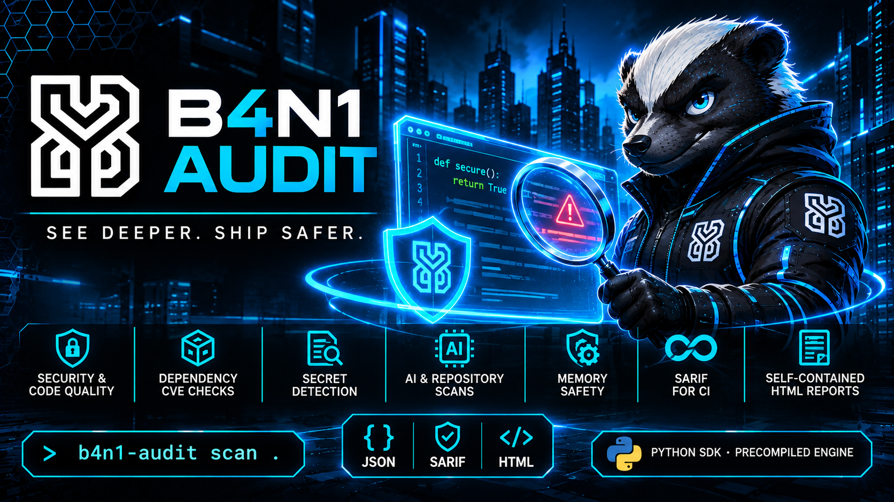

<p align="center">
  
</p>

# b4n1-audit

Security and code-quality scanner — one native core, thin wrappers for Python, JavaScript, Java and C#.

[English](README.md) · [Español](i18n/README.es.md) · [Deutsch](i18n/README.de.md) · [Français](i18n/README.fr.md) · [Italiano](i18n/README.it.md) · [Português (BR)](i18n/README.pt-BR.md) · [Русский](i18n/README.ru.md) · [العربية](i18n/README.ar.md) · [हिन्दी](i18n/README.hi.md) · [日本語](i18n/README.ja.md) · [한국어](i18n/README.ko.md) · [中文](i18n/README.zh-CN.md)

[](https://pypi.org/project/b4n1-audit/)
[](https://pypi.org/project/b4n1-audit/)
[](https://pypi.org/project/b4n1-audit/)
[](LICENSE)

Python wrapper for the `b4n1-audit` engine — a security and code-quality
scanner that ships as a single precompiled binary. The binary is bundled per
platform inside the wheel; there is nothing to compile and no external runtime.

## Install

```bash
pip install b4n1-audit
```

Requires Python ≥ 3.8. Precompiled binary included (Linux x64/arm64, Windows x64).

## Quick start

```python
from b4n1audit import run, binary_path, AuditError

print(binary_path())          # resolved binary path (fails loud if none)
report = run("json", ".")     # dict/list parsed from JSON output
sarif  = run("sarif", ".")    # SARIF document as text
```

`run()` raises `AuditError` (with the binary's stderr) when the process exits
non-zero. Binary resolution order: `B4N1_AUDIT_BIN` → bundled binary → `PATH`.

## What it scans

The SDK exposes the full engine surface, for example:

| Verb | Purpose |
|------|---------|
| `scan` / `json` | Directory scan, JSON report |
| `sarif` | SARIF output for CI integration |
| `cve-check` | Dependency CVE check against an embedded database |
| `secrets` | API keys / tokens in files and history |
| `scan-ai` | Prompt injection, MCP and repo-poisoning checks |
| `memory` | Memory-safety issues (leaks, UB, overflows) |
| `semgrep` | Fast-path rule engine |
| `report` | Self-contained HTML report |

```bash
# via the bundled binary directly
python -c "from b4n1audit import binary_path; import sys; print(binary_path())"
$(python -c "from b4n1audit import binary_path; print(binary_path())") scan .
```

## License

Distributed under the Business Source License 1.1 (BUSL-1.1) plus an EULA for
the bundled binary. Source code is proprietary.
