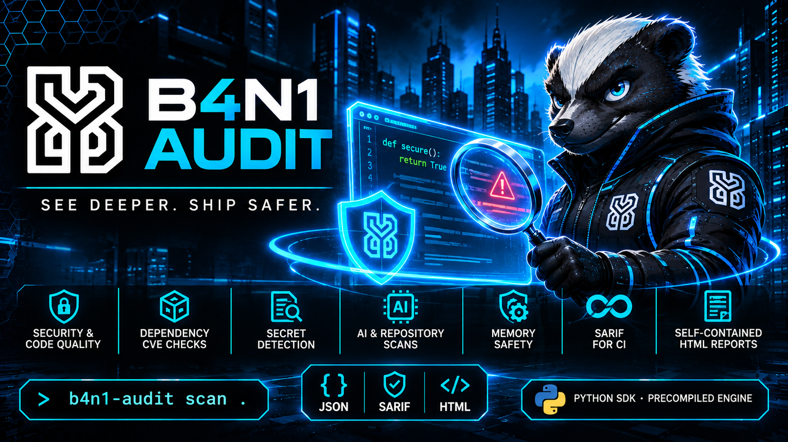

<p align="center">
  
</p>

# b4n1-audit — JavaScript SDK

[](https://www.npmjs.com/package/b4n1-audit)
[](https://www.npmjs.com/package/b4n1-audit)
[](LICENSE)

Node.js wrapper for the `b4n1-audit` engine — a security and code-quality
scanner shipped as a single precompiled binary per platform. No native build,
no external runtime.

## Install

```bash
npm install b4n1-audit
```

The precompiled binary is bundled per platform in `bin/`
(Linux x64/arm64, Windows x64).

## Quick start

```javascript
const { run, binaryPath, AuditError } = require("b4n1-audit");

console.log(binaryPath());            // resolved binary path (fails loud if none)
const report = run("json", ".");      // parsed object (JSON) or string
// also: run(["json", "."], { timeout: 60000 })
```

`run()` throws `AuditError` (with the binary's stderr) when the process exits
non-zero. Binary resolution order: `B4N1_AUDIT_BIN` → bundled binary → `PATH`.

## What it scans

The full engine surface is exposed, e.g. `scan`, `json`, `sarif`, `cve-check`,
`secrets`, `scan-ai`, `memory`, `semgrep`, `report`. See the Python SDK README
for the verb table.

## License

Business Source License 1.1 (BUSL-1.1) plus an EULA for the bundled binary.
Source code is proprietary.
